<div align="center">

# 📱 Курс BNM — мобильный конвертер

**Лабораторная работа 4 по PSI** · Dmitrii Anghis, группа TI-235 · УТМ, 2026

Android-приложение на **Kotlin + Jetpack Compose**: конвертер валют по официальному курсу **Национального банка Молдовы**, таблица всех курсов, сравнение курса за неделю и за месяц с графиком и статистикой, журнал конвертаций с экспортом в CSV.

[](https://github.com/DmitriiAnghis/currency-mobile/actions/workflows/tests.yml)


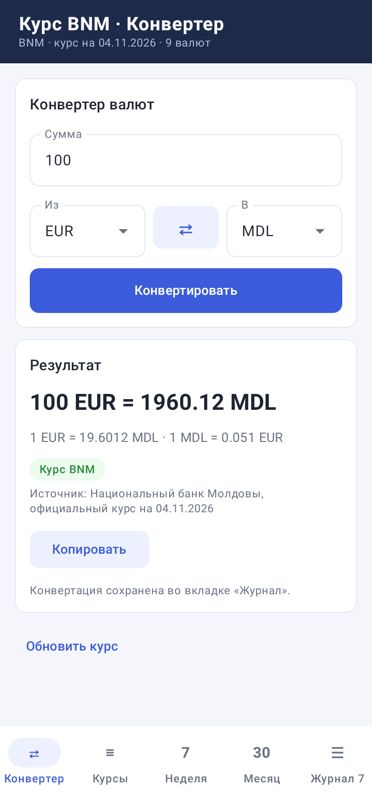

</div>

**Содержание:** [Возможности](#-возможности) · [Быстрый старт](#-быстрый-старт) · [Интерфейс](#-интерфейс) · [Тесты](#-тесты) · [Структура](#-структура-проекта) · [Git](#-работа-с-git) · [Уведомления](#-уведомления-о-коммитах-на-почту)

---

## ✨ Возможности

- **Официальный курс BNM**: XML с `bnm.md`, все валюты BNM и MDL, с учётом номинала (например, 100 RUB).
- **Точная арифметика**: `BigDecimal`, результат до двух знаков (half-up), плюс прямой и обратный курс.
- **Кросс-курсы**: любая пара, например USD → EUR, считается через MDL.
- **Неделя и месяц**: график курса пары за 7 и 30 дней, минимум, максимум, среднее, изменение в единицах и процентах, тенденция (рост, падение, без изменений).
- **Работа без сети**: каждый ответ BNM сохраняется в файл во внутренней памяти. Без сети приложение показывает последний сохранённый курс и честно пишет, от какой он даты.
- **Выходные и праздники**: если на сегодня курса нет, берётся последний опубликованный, с пояснением.
- **Проверка ввода**: запятая или точка, отказ на пустое, ноль, минус и буквы.
- **Таблица курсов**: все валюты BNM на дату, поиск, нажатие открывает валюту в конвертере.
- **Журнал конвертаций**: сохраняется после перезапуска, поиск, повтор, удаление с возвратом, очистка с подтверждением.
- **Экспорт в CSV** журнала и курсов через «Поделиться» (почта, мессенджер, Диск), файл открывается в Excel. Результат можно скопировать.

## 🚀 Быстрый старт

Нужны **Android Studio** и **JDK 21** (встроенный в Android Studio подходит).

1. **File → Open** и выбрать папку проекта. Путь к папке должен быть **без русских букв** (например, `C:\Users\<имя>\dev\currency-mobile`), иначе Gradle не соберёт проект.
2. Дождаться, пока внизу закончится **Gradle Sync**.
3. Вверху выбрать конфигурацию **app** и эмулятор (например, **Pixel 8**), нажать зелёный **▶ Run**.

Готовый APK можно скачать без сборки: **Actions → последний запуск Tests → Artifacts → app-debug-apk**.

Из командной строки:
```bash
./gradlew :app:installDebug                  # установить на эмулятор или телефон
./gradlew :app:testDebugUnitTest :core:test  # все тесты
SKIP_ANDROID=1 ./gradlew :core:test          # только логика, без Android SDK
```

## 🪟 Интерфейс

Всё в **одном окне с пятью вкладками** внизу, без всплывающих окон:

| Вкладка | Что делает |
|---|---|
| **⇄ Конвертер** | Сумма, валюты «Из» и «В», кнопка **⇄** меняет их местами. **Конвертировать** (или **Готово** на клавиатуре) показывает результат в карточке: сумма, прямой и обратный курс, плашка источника (зелёная «Курс BNM» или оранжевая «Сохранённый курс») и дата. **Копировать** кладёт результат в буфер обмена. Каждая конвертация попадает в журнал. |
| **≡ Курсы** | Все официальные курсы на дату: код, название, номинал, MDL за 1 единицу. Поиск по коду и названию. Нажатие на строку открывает конвертер с этой валютой. **Поделиться CSV** отправляет таблицу. |
| **7 Неделя** | Пара валют, график за 7 дней, плитки «Минимум», «Максимум», «Среднее», «Изменение» и плашка тенденции. |
| **30 Месяц** | То же за 30 дней. |
| **☰ Журнал** | Все конвертации, новые сверху, число записей на вкладке. Поиск по валюте, сумме и дате. **Повторить** заново считает запись по текущему курсу, **Удалить** убирает её (в полосе есть **Вернуть**), **Очистить всё** спрашивает подтверждение в полосе. **Поделиться CSV** отправляет то, что видно в списке. |

- В **тёмной шапке** видно, какие курсы сейчас загружены: источник, дата и число валют.
- Ошибка ввода показывается красным прямо под полем «Сумма».
- Нет сети или нет данных: вверху появляется **оранжевая** или **красная полоса**, у красной есть кнопка **Повторить**.

<table>
<tr>
<td align="center"><br>EUR → MDL по курсу BNM</td>
<td align="center">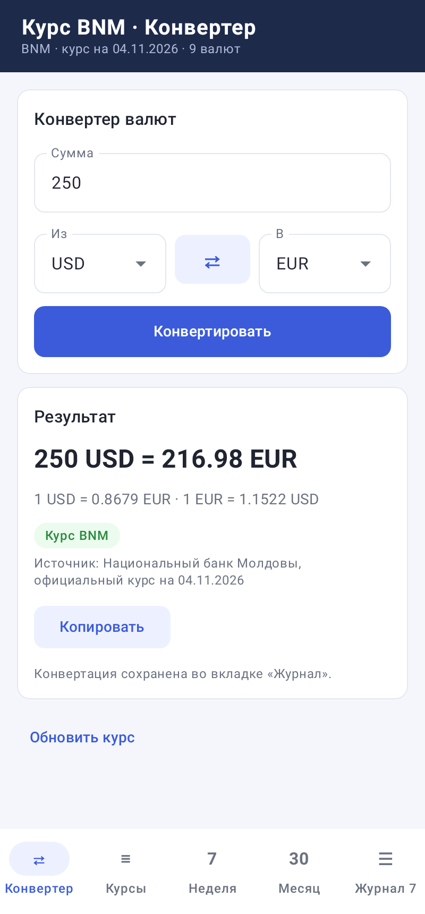<br>Кросс-курс USD → EUR</td>
<td align="center">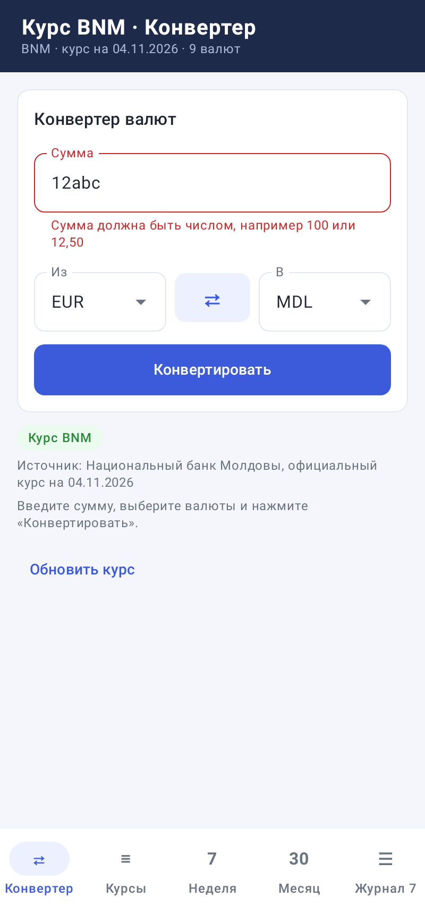<br>Ошибка ввода под полем</td>
</tr>
<tr>
<td align="center">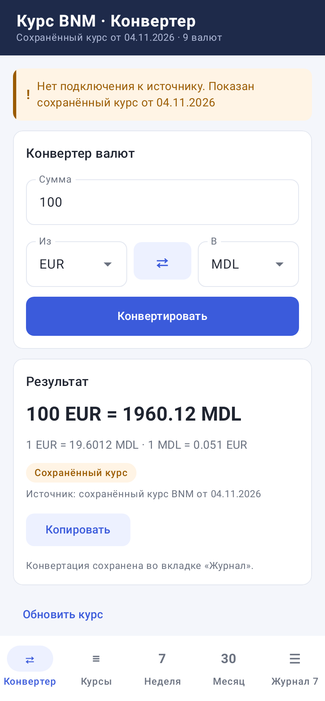<br>Без сети: сохранённый курс</td>
<td align="center">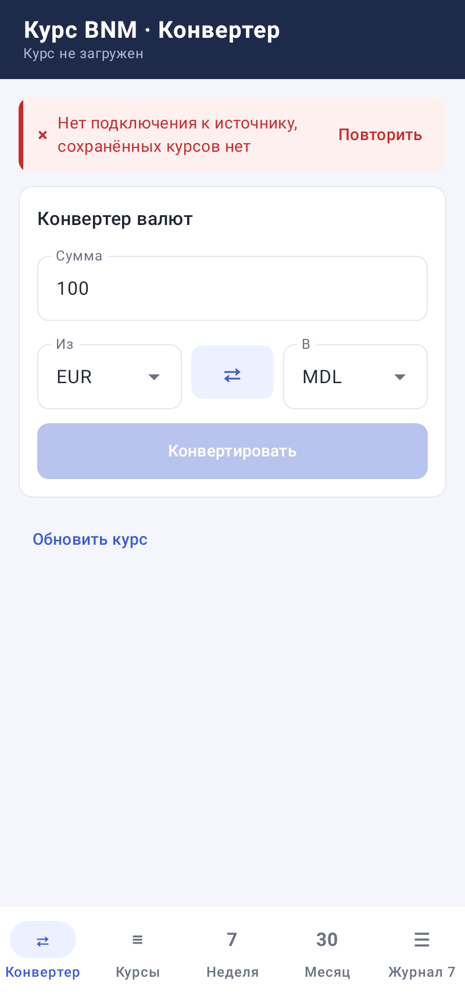<br>Нет сети и нет кэша</td>
<td align="center">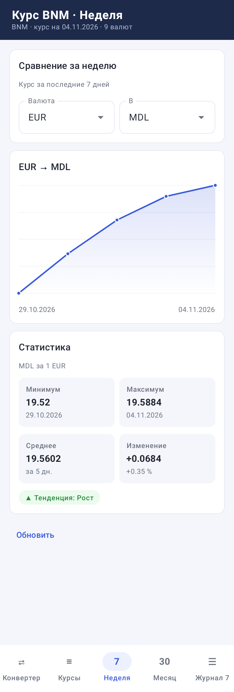<br>Сравнение за неделю</td>
</tr>
<tr>
<td align="center">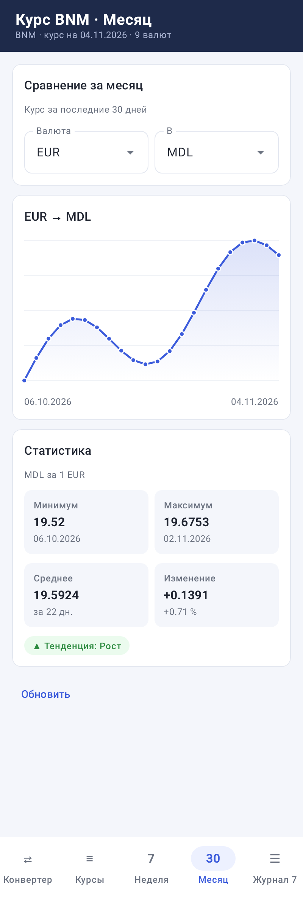<br>Сравнение за месяц</td>
<td align="center">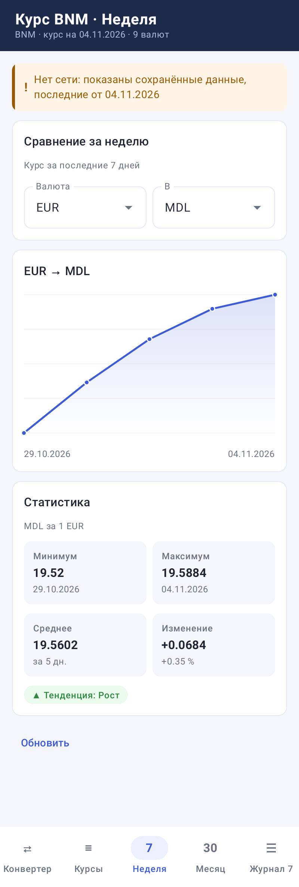<br>Неделя без сети</td>
<td align="center">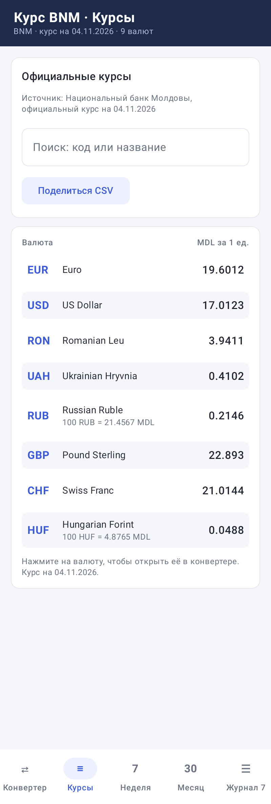<br>Все курсы BNM</td>
</tr>
<tr>
<td align="center">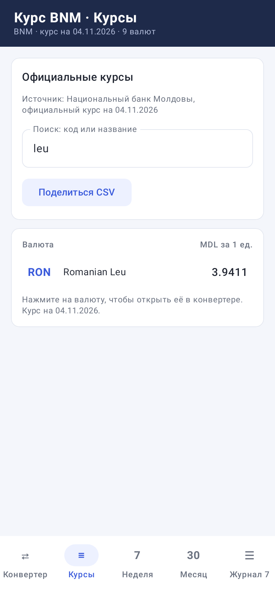<br>Поиск по курсам</td>
<td align="center">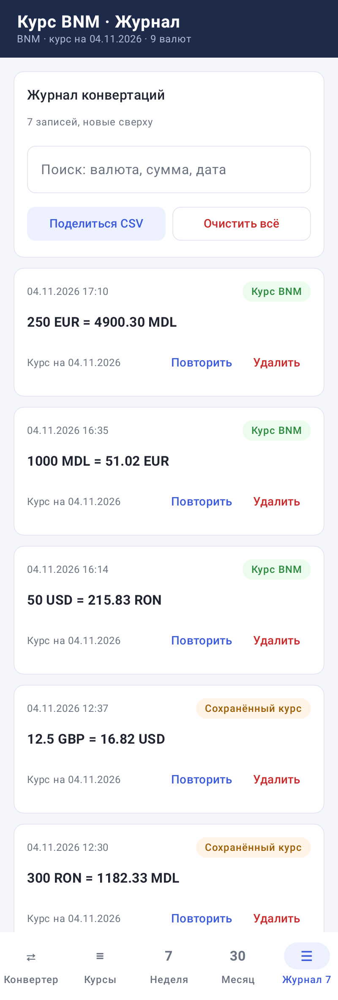<br>Журнал конвертаций</td>
<td align="center">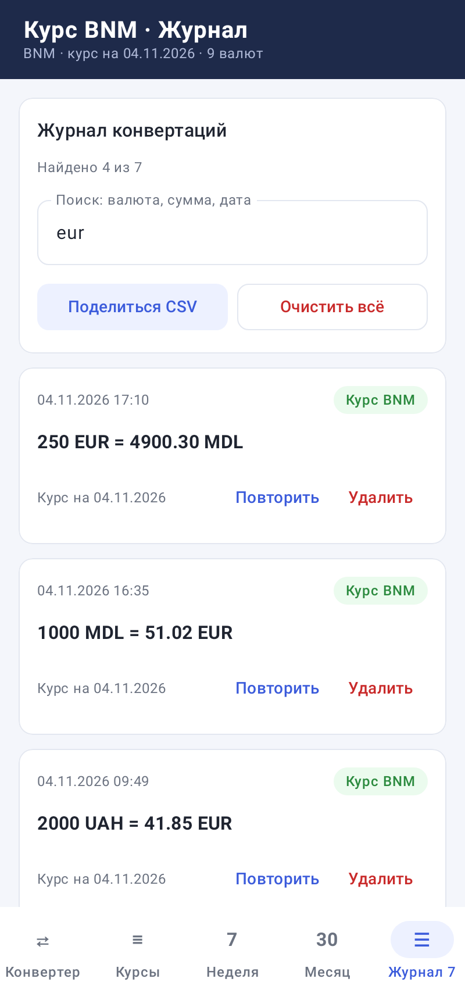<br>Поиск по журналу</td>
</tr>
<tr>
<td align="center">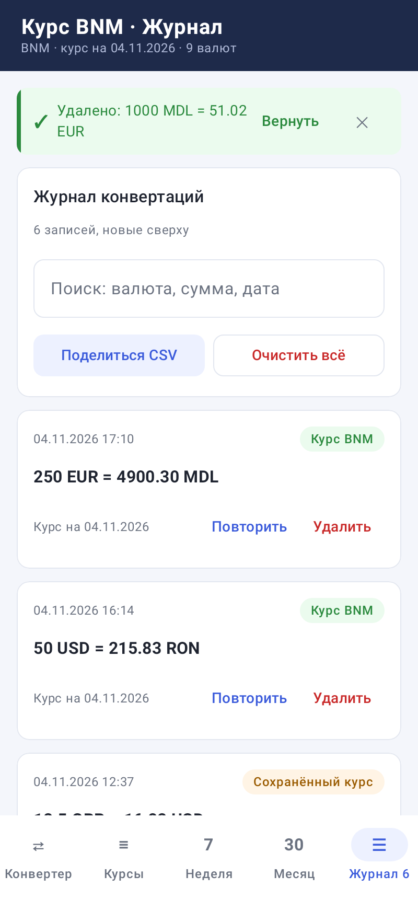<br>Удаление с «Вернуть»</td>
<td align="center">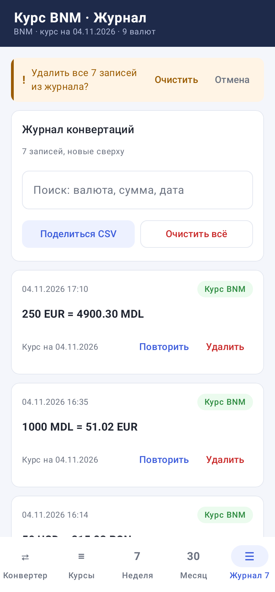<br>Очистка: подтверждение в полосе</td>
<td align="center">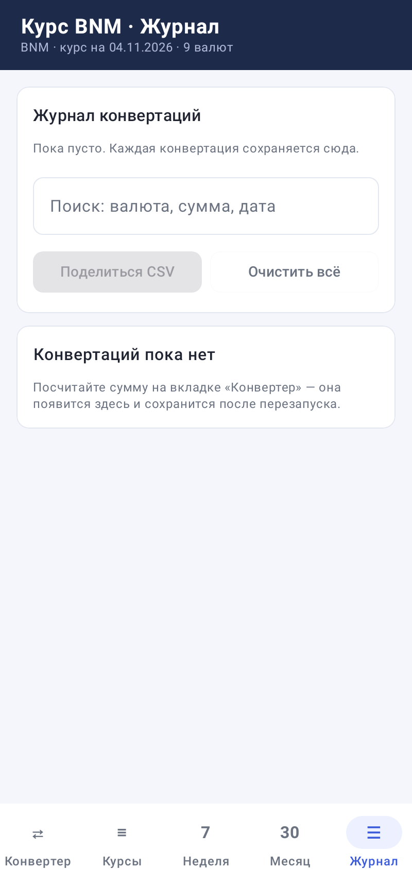<br>Пустой журнал</td>
</tr>
</table>

> Скриншоты рисует тест [`ScreenshotTest`](app/src/test/kotlin/md/anghis/currency/ui/ScreenshotTest.kt) (Robolectric + Roborazzi) на демонстрационных курсах, поэтому они всегда совпадают с текущим кодом. В GitHub Actions они обновляются автоматически.

## 🧪 Тесты

| Модуль | Что проверяется | Тестов |
|---|---|---|
| `core` | разбор XML BNM, конвертация и кросс-курсы, проверка суммы, статистика, кэш, выходные, работа без сети, журнал (сохранение, повреждённый файл, удаление и возврат, лимит, поиск, CSV), таблица курсов | 46 |
| `app` | строка в шапке, порядок валют, текст результата, подписи журнала, отрисовка 15 экранов | 24 |

Тесты запускаются в **GitHub Actions** при каждом push и Pull Request: `core` на Linux и Windows, `app` на Linux вместе со сборкой APK. Результат во вкладке **Actions**, значок вверху README зелёный, когда всё прошло.

## 📁 Структура проекта

```
core/   чистый Kotlin без Android: Model, BnmXmlParser, Converter, AmountValidator,
        Statistics, RatesRepository (кэш, история, работа без сети),
        ConversionLog (журнал и CSV), RatesTable (таблица курсов) + unit-тесты
app/    Android-приложение
  data/ BnmHttpSource (HTTP к bnm.md), FileRateCache (файлы rates/ГГГГ-ММ-ДД.xml),
        FileLogStorage (журнал history.txt), CsvShare (CSV через «Поделиться»)
  ui/   AppViewModel, CurrencyApp (шапка и вкладки), ConverterScreen, RatesScreen,
        ComparisonScreen, JournalScreen,
        Components (карточки, полосы-сообщения, выбор валюты), Theme (палитра)
docs/screenshots/app/   скриншоты экранов из ScreenshotTest
REPORT.md               отчёт по лабораторной
```

## 🌿 Работа с Git

- Работа шла по веткам: `feature/core-logic` → `feature/android-ui` → `docs/report`, каждая попала в `main` через Pull Request.
- Оформление интерфейса, скриншоты и Actions добавлены отдельным Pull Request, курсы, журнал и экспорт — следующим.
- История видна во вкладке **Pull requests → Closed**.

## 📬 Уведомления о коммитах на почту

Workflow [`.github/workflows/notify-push.yml`](.github/workflows/notify-push.yml) при каждом push присылает письмо со списком новых коммитов. Пока секреты не заданы, он ничего не делает. Чтобы включить: **Settings → Secrets and variables → Actions → New repository secret**, и добавить:

| Секрет | Значение |
|---|---|
| `MAIL_USERNAME` | адрес отправителя, например Gmail-адрес |
| `MAIL_PASSWORD` | пароль приложения (Gmail: Google Account → Security → App passwords) |
| `MAIL_TO` | куда слать письма |

По умолчанию используется SMTP Gmail (`smtp.gmail.com:465`). Для другой почты добавь секреты `MAIL_SERVER` и `MAIL_PORT`.
